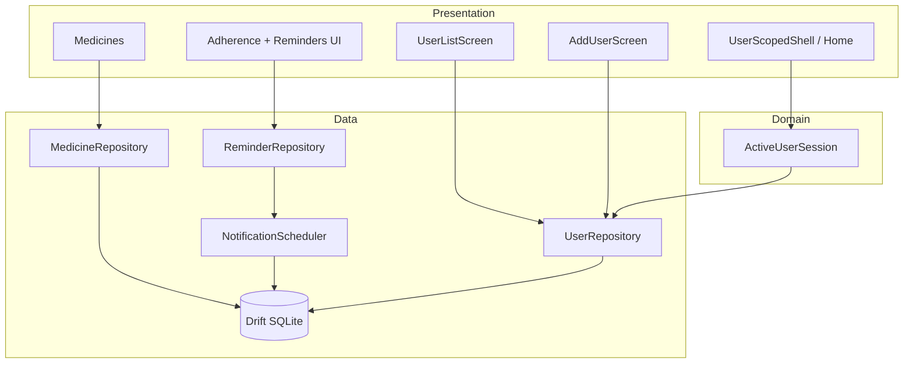

# App Finetuning — User-Specific Reminders & Offline Profiles

**Status:** Planning (no implementation in this document).  
**Parent plan:** [implementaion.plan.md](./implementaion.plan.md) — assumes Phases P5 (Drift) and P6 (reminders) are in place or in progress.  
**Repository snapshot:** 2026-10-14 — schema already includes `users` and `userId` on tenant tables; **`lib/features/users/` and profile UX are not implemented**; router `initialLocation` is `/` → medicines list without profile selection.

**Next action:** Execute [Step-by-step todos](#step-by-step-todos) in order; mark frontmatter `status` as each item completes.

---

## Step-by-step todos

Execute in order. Later steps may parallelize only where dependencies allow.

### Phase MF-A — Discovery and session model

- [ ] **Step 1 · MF-01** — Grep for `userId`, empty string defaults, and any single implicit profile ID. Produce a short inventory in `docs/architecture.md` (ADR: multi-user session).
- [ ] **Step 2 · MF-02** — `UserRepository` + `DriftUserRepository`: `watchAllUsers()`, `createUser(displayName)`, `updateDisplayName`, `deleteUser(id)` (with pre-delete guard if last user).
- [ ] **Step 3 · MF-03** — `activeUserIdProvider` (sync read) + `activeUserProvider` (stream/display name). Persist `last_active_user_id` via `shared_preferences` (or existing prefs helper). On cold start: restore last user **only if** that row still exists; else clear and show user list.

### Phase MF-B — Entry UX (user list + add user)

- [ ] **Step 4 · MF-04** — `UserListScreen`: shows all profiles (display name, created date, optional med count). Empty state CTA → add user (not a default auto-created profile on first paint).
- [ ] **Step 5 · MF-05** — `AddUserScreen` / dialog: validate non-empty trimmed name; create UUID; navigate into that user’s home. **This is the intended first-run path** when `users` table is empty.
- [ ] **Step 6 · MF-13** — Router:
  - `GET /users` — list (also used when switching profile from app bar).
  - `GET /users/add` — add user.
  - `GET /users/:userId` — redirect to `.../home`.
  - `GET /users/:userId/home` — medicines list (current home).
  - Child routes: `capture`, `adherence`, prescription flows carry `:userId` in path or `extra` consistently.
  - **Redirect rule:** if no users → `/users/add`; if users exist but no valid active session → `/users`.

### Phase MF-C — Data scoping (offline per user)

- [ ] **Step 7 · MF-07** — Medicine, prescription, reminder repositories: **require** `userId` on writes; default reads filter `WHERE userId = ?`. Remove or deprecate `listConfirmed({String? userId})` optional filter — callers must pass active profile.
- [ ] **Step 8 · MF-06** — Wire presentation: `MedicineListScreen`, `CaptureScreen`, `AdherenceScreen`, extraction confirm paths read `userId` from route/session provider, never from a global constant.
- [ ] **Step 9 · MF-08** — `PrescriptionImageStore`: paths `.../users/{userId}/prescriptions/{prescriptionId}/` (align with parent plan §7). Migration moves existing `prescriptions/tmp/` files when MF-14 runs.
- [ ] **Step 10 · MF-14** — Drift migration v2 (if needed): attach orphan `userId` rows to a migrated profile; run `ensureUserExists` once for legacy default; document in `docs/data-model.md`.

### Phase MF-D — Notifications and alarms (username visible)

- [ ] **Step 11 · MF-09** — `NotificationScheduler` payload contract:
  - **Title:** `{displayName} — Medicine reminder` (or localized template).
  - **Body:** `{medicineName} · {doseInstructions or timing}`.
  - **Android channel:** single channel OK; differentiation is copy, not per-user channels (unless OEM testing requires split).
- [ ] **Step 12 · MF-10** — Notification ID = deterministic hash of `userId` + `reminderEventId` (document in `reminder_event_id.dart`). Cancel/reschedule must use same ID. Prevents User A’s cancel from clearing User B’s alarm.
- [ ] **Step 13 · MF-11** — `reminder_bootstrap` / `BootReceiver`: load **all** pending `reminder_events` grouped by `userId`; join `users.displayName` for copy; reschedule each. Reconciliation (`reminder_reconciliation.dart`) runs per user or with userId in dedupe keys.
- [ ] **Step 14 · MF-12** — On `deleteUser`: cancel all scheduled notifications for that `userId`; delete encrypted images under user folder; rely on FK CASCADE for DB rows.

### Phase MF-E — Polish and verification

- [ ] **Step 15 · MF-15** — Tests: create two users → meds only on respective lists; notification title contains correct name; delete user removes alarms. Update `docs/data-model.md` tenancy section and `docs/testing.md` manual checklist.

### Milestone map

| Milestone | Steps | Outcome |
|-----------|-------|---------|
| MF-A | 1–3 | Session + repository foundation |
| MF-B | 4–6 | User list / add user as app entry |
| MF-C | 7–10 | All data and images scoped by profile |
| MF-D | 11–14 | Named notifications; safe IDs; reboot |
| MF-E | 15 | Docs + tests |

---

## 1. Executive summary

The core app already models **local multi-user tenancy** in SQLite (`users` table, `userId` FK on prescriptions, medicines, reminder_events, adherence_entries) per parent plan **assumption A6** and **§7.0**. What is missing is **product behavior**: users must **choose or create a profile** before managing medicines; each profile’s data stays isolated offline in the same DB; reminders and system notifications must **show whose dose** it is using the profile **display name** (username).

This finetuning plan does **not** add cloud accounts, sync, or family sharing. It delivers **device-local household profiles** (e.g. parent managing multiple family members) with correct notification labeling and scheduling.

---

## 2. Current state vs target

| Area | Current (observed) | Target |
|------|-------------------|--------|
| `users` table | Defined in Drift | CRUD + UI |
| `user_bootstrap.dart` | `ensureUserExists` on prescription insert | Also used from `createUser`; not a silent default on app launch |
| Router | `/` → medicines | `/users` or `/users/:userId/home` |
| `lib/features/users/` | Planned in §6.2, **absent** | List, add, switch, delete |
| Repositories | `userId` columns; optional filter on list | Mandatory active `userId` |
| Notifications | Phase 6 scheduler (parent plan) | Copy includes `displayName`; IDs scoped per user |
| Images | Global `prescriptions/tmp/` in docs | Per-user paths per §7 |
| Acceptance (parent §14.2) | Criteria 1, 4, 6 mention profile | Explicitly satisfied by this work |

---

## 3. User journeys

### 3.1 First launch (no users)

```mermaid
flowchart LR
  Launch[App launch] --> Empty{users count = 0?}
  Empty -->|yes| Add[/users/add]
  Add --> Create[Create profile name]
  Create --> Home[/users/:id/home]
```

No automatic “Default profile” row unless **MF-14** migration creates one from legacy data.

### 3.2 Returning user

1. Restore `last_active_user_id` if valid → open that user’s home.
2. Else show **user list** → tap profile → home.

### 3.3 Switch profile (in app)

- App bar action: “Switch user” → `/users` (list). Selecting another profile updates session + navigates to their home. **Optional:** prompt to confirm switch mid-capture (discard or keep draft scoped to old `userId`).

### 3.4 Add another user

- From user list: FAB / “Add user” → `/users/add` → name → new `userId` → empty medicine list for that profile only.

### 3.5 Reminder fires

- System tray shows e.g. **“Priya — Medicine reminder”** with body **“Metformin 500mg · After breakfast”**.

---

## 4. Architecture

### 4.1 Layer additions



### 4.2 Active profile rule

**Single rule:** every use case that reads or writes tenant data receives `userId` from:

1. **Route parameter** `:userId` (preferred for deep links and tests), validated against DB; or  
2. **`activeUserIdProvider`** when route is nested under `/users/:userId/...`.

Extraction pipeline step **0** in parent plan §4.2: *“Active profile → all reads/writes scoped to selected `userId`.”*

### 4.3 Proposed files (new / modify)

| Path | Status | Responsibility |
|------|--------|----------------|
| `lib/features/users/domain/user_profile.dart` | N | Immutable profile model (`id`, `displayName`, timestamps) |
| `lib/features/users/data/user_repository.dart` | N | Abstract CRUD |
| `lib/features/users/data/drift_user_repository.dart` | N | Drift implementation |
| `lib/features/users/application/active_user_controller.dart` | N | Riverpod notifier: set/clear active, persist prefs |
| `lib/features/users/presentation/user_list_screen.dart` | N | List + navigate |
| `lib/features/users/presentation/add_user_screen.dart` | N | Create profile |
| `lib/features/users/presentation/user_switcher_button.dart` | N | App bar menu |
| `lib/app/di/providers.dart` | M | Register user + active session providers |
| `lib/app/router.dart` | M | User-first routes + redirects |
| `lib/features/medicines/presentation/medicine_list_screen.dart` | M | Accept `userId`; show display name in title |
| `lib/features/prescription/**` | M | Pass `userId` from route (already on some screens) |
| `lib/features/reminders/data/notification_scheduler.dart` | M | Title/body templates + user-scoped IDs |
| `lib/features/reminders/data/reminder_bootstrap.dart` | M | Multi-user reschedule |
| `lib/features/prescription/data/prescription_image_store.dart` | M | Per-user directories |
| `lib/data/database/migrations.dart` | M | v2 legacy path migration (if needed) |
| `docs/data-model.md` | M | Tenancy UX + image paths |
| `docs/architecture.md` | M | ADR: local profiles, notification ID scheme |

---

## 5. Data and offline isolation

### 5.1 Storage model (unchanged from parent plan)

- **One** SQLite file; isolation via **`userId`**, not separate database files per person.
- **Offline:** all profiles’ data remain on device; switching user does not require network.
- **Cascade delete:** deleting a user removes prescriptions → medicines → reminder_events → adherence_entries (existing FK design).

### 5.2 Display name as “username”

- Product copy uses **display name** entered at profile creation (no login username).
- Validation: 1–64 chars, trim whitespace, reject all-whitespace.
- Uniqueness: display names **may duplicate** (two “Mom” profiles allowed); distinction is internal `userId` (show subtle subtitle or created date in list if needed).

### 5.3 Notification payload (Android)

| Field | Content |
|-------|---------|
| `title` | `{displayName} — {localizedReminderTitle}` |
| `body` | `{medicineName}` + optional dose/timing |
| `payload` / `data` | JSON: `{ "userId", "reminderEventId", "medicineId" }` for tap → open adherence for **that** user |

Tap handler: navigate to `/users/:userId/adherence` (or home with snackbar if user deleted).

### 5.4 Scheduling scope

- **Plan/reminder generation:** only for medicines where `medicine.userId == activeUserId` at confirm time.
- **Background reschedule:** iterate all users with pending events (boot, timezone change, reconciliation).

---

## 6. Security and privacy

| Topic | Approach |
|-------|----------|
| PHI in notifications | Show medicine name only on lock screen if user accepts Android notification visibility; document in settings later (out of scope: per-user “hide names on lock screen”). |
| Profile deletion | Destructive confirm dialog; no undo |
| Logs | Never log `displayName` + medicine together in release builds (parent §11) |
| Cross-profile leakage | Widget tests assert User B list empty when browsing as User A |

---

## 7. Task checklist (sync with root `TODO.md`)

Add IDs **MF-01** … **MF-15** to `TODO.md` when implementation starts.

| ID | P | Task | Paths | Deps | Acceptance | Verify |
|----|---|------|-------|------|------------|--------|
| MF-01 | P0 | Call-site audit | `lib/**` | — | Inventory doc | review |
| MF-02 | P0 | User repository | `features/users/data/**` | P5-01 | CRUD users | unit test |
| MF-03 | P0 | Active session | `features/users/application/**` | MF-02 | Persists + restores | unit test |
| MF-04 | P0 | User list UI | `user_list_screen.dart` | MF-02 | Lists all profiles | widget test |
| MF-05 | P0 | Add user flow | `add_user_screen.dart` | MF-02 | Empty DB → add only | integration |
| MF-06 | P0 | Scoped shell | medicines, capture, adherence | MF-03, MF-13 | Data filtered | integration |
| MF-07 | P0 | Repo scoping | `*_repository.dart` | MF-03 | No unscoped lists | unit test |
| MF-08 | P1 | Image paths | `prescription_image_store.dart` | MF-14 | Files under user dir | inspection |
| MF-09 | P0 | Notification copy | `notification_scheduler.dart` | P6-02 | Name in title | device |
| MF-10 | P0 | Notification IDs | `reminder_event_id.dart` | MF-09 | No ID collision | unit test |
| MF-11 | P0 | Boot reschedule all users | `BootReceiver.kt`, bootstrap | P6-03 | Both users fire | reboot test |
| MF-12 | P1 | Delete user cleanup | user repo + scheduler | MF-10 | Alarms cancelled | unit + device |
| MF-13 | P0 | Router | `router.dart` | MF-04 | Redirects correct | widget test |
| MF-14 | P1 | Legacy migration | `migrations.dart` | MF-08 | Old data visible | migration test |
| MF-15 | P1 | Docs + tests | `docs/**`, `test/**` | MF-11 | Parent §14.2 #1,4,5,6 | `flutter test` |

---

## 8. Testing strategy

| Layer | Cases |
|-------|--------|
| Unit | Notification ID hash stable; user repository CRUD; migration attaches orphan rows |
| Widget | User list empty state; add user validation; medicine list title shows name |
| Integration | User A confirm med → User B list empty; switch user → correct count |
| Device | Two profiles, two schedules, notifications show correct names; reboot reschedule |
| Manual | Airplane mode: create user, add med, confirm, reminder fires with name offline |

---

## 9. Acceptance criteria (this finetuning)

1. **Entry:** On first launch, user is guided to **add a profile** (no silent default unless migrating legacy data).
2. **List:** User list shows all local profiles; tapping one opens that profile’s medicine home.
3. **Isolation:** Medicines, prescriptions, adherence, and reminder_events are visible and mutable only in the context of the selected `userId`.
4. **Notifications:** Fired reminders display the **profile display name** in the title (or equally prominent line per platform guidelines).
5. **Alarms:** Reschedule and cancel operations do not affect other profiles’ pending notifications.
6. **Offline:** Entire flow works without network after install.
7. **Parent alignment:** Satisfies [implementaion.plan.md](./implementaion.plan.md) §14.2 items **1, 4, 5, 6** for multi-profile behavior.

---

## 10. Out of scope (v1 finetuning)

- Cloud sync, backup export/import (mentioned as optional in parent A6).
- PIN/biometric lock per profile.
- iOS-specific notification grouping (Android-first; follow-up if iOS ships).
- Renaming user mid-flight notification content until next reschedule (acceptable: update on next reconcile).

---

## 11. References

- Parent tenancy: [implementaion.plan.md](./implementaion.plan.md) — §3.2 A6, §4.2 step 0, §6.2 `lib/features/users/`, §7.0, §7.6, §14.2.
- Implemented schema: `docs/data-model.md` — `users` table and `userId` FKs.
- Bootstrap helper: `lib/data/database/user_bootstrap.dart`.

---

*End of finetuning plan. Implement MF-01 onward after approval.*
