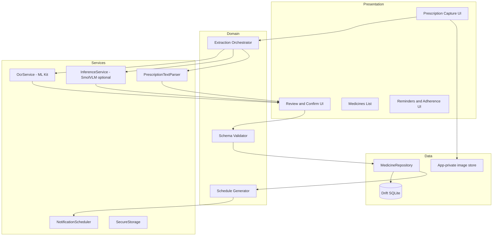
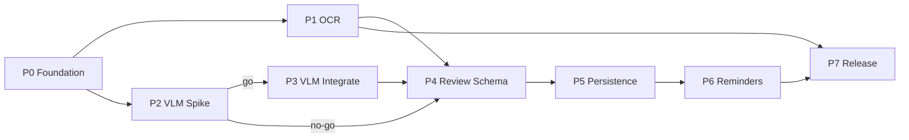

# Offline-First Flutter Medicine Reminder — Implementation Plan

**Status:** Planning complete (no application code changed).  
**Repository snapshot:** 2026-10-10 — `main` branch, **no commits**, only `.git/` and `.cursor/`.  
**Next action:** Work todos top-to-bottom in [Step-by-step todos](#step-by-step-todos); mark frontmatter `status` as you complete each item.

---

## Step-by-step todos

Execute in order. **Phase 3** items apply only if **P2-07** is **go**; if **no-go**, skip P3-01–P3-07 and continue at P4-01. Task tables and acceptance criteria remain in [§12](#12-prioritized-todomd-checklist).

### Phase 0 — Foundation

- [ ] **Step 1 · P0-01** — `flutter create` project; `flutter build apk` succeeds.
- [ ] **Step 2 · P0-02** — Scaffold `lib/app`, `lib/features/*`, `lib/services/*`, `lib/shared/*`, `lib/data/*` per §6.
- [ ] **Step 3 · P0-03** — Add `flutter_riverpod`, `go_router`, `drift`, dev codegen; `flutter pub get`.
- [ ] **Step 4 · P0-04** — `README.md` (setup, build commands) + `docs/architecture.md` (layers, ADR stubs).
- [ ] **Step 5 · P0-05** — Root `TODO.md` with every ID from §12 (status `todo`).
- [ ] **Step 6 · P0-06** — `android/`: `minSdk = 24`, `compileSdk`/`targetSdk` latest stable; note `com.google.mlkit:text-recognition:16.0.1` for Phase 1.

### Phase 1 — Offline OCR

- [ ] **Step 7 · P1-01** — `image_picker`/`camera` → `prescription_image_store.dart` (app-private paths only).
- [ ] **Step 8 · P1-02** — Shared `image_preprocessor.dart` (rotate, max dimension) + unit tests.
- [ ] **Step 9 · P1-03** — `google_mlkit_text_recognition` + bundled ML Kit dep; `mlkit_ocr_service.dart`.
- [ ] **Step 10 · P1-04** — `ocr_review_screen.dart` + router route; widget test.
- [ ] **Step 11 · P1-05** — `docs/offline-capabilities.md`: airplane-mode OCR checklist.
- [ ] **Step 12 · P1-06** — `ocr_rules_extraction_service.dart` → `MedicationExtractionDraft` with explicit `missing` fields.

### Phase 2 — SmolVLM feasibility spike

- [ ] **Step 13 · P2-01** — `assets/models/model_manifest.json` (revision `a7da5b9…`, URLs, sizes, checksums TBD).
- [ ] **Step 14 · P2-02** — Download `vision_encoder_q4f16.onnx`, `embed_tokens_q4f16.onnx`, `decoder_model_merged_q4f16.onnx` to `tool/model_spike/`.
- [ ] **Step 15 · P2-03** — `tool/model_spike/inspect_onnx.py`; document ops/I/O in `docs/model-research.md`.
- [ ] **Step 16 · P2-04** — `run_reference.py` full generation on desktop; save sample output for regression.
- [ ] **Step 17 · P2-05** — Load each ONNX session on Android (plugin or `SmolVlmOnnxBridge.kt` spike).
- [ ] **Step 18 · P2-06** — Profiler: peak RSS, cold/warm latency on 4 GB physical device.
- [ ] **Step 19 · P2-07** — **Decision gate:** write **go** or **no-go** vs §5.4 criteria in `docs/model-research.md`.

### Phase 3 — VLM integration (go only)

- [ ] **Step 20 · P3-01** — `medication_extraction_service.dart` + wire OCR impl; stub VLM impl if no-go.
- [ ] **Step 21 · P3-02** — On-demand model download UI + resume + checksum verify.
- [ ] **Step 22 · P3-03** — `tokenizer_service.dart` aligned with `tokenizer.json` + chat template.
- [ ] **Step 23 · P3-04** — VLM branch of `image_preprocessor.dart` (Idefics3); tensor shape unit tests.
- [ ] **Step 24 · P3-05** — `smolvlm_generation_loop.dart` (KV cache, ≥50 tokens on device).
- [ ] **Step 25 · P3-06** — JSON extraction prompt + parse to draft; integration test.
- [ ] **Step 26 · P3-07** — Cancellation, `dispose()`, 10× repeat inference without OOM/leak.

### Phase 4 — Schema and confirmation

- [ ] **Step 27 · P4-01** — `field_confidence.dart`, `medication_draft.dart`, JSON serde tests.
- [ ] **Step 28 · P4-02** — `extraction_validator.dart`; no active schedule without confirm.
- [ ] **Step 29 · P4-03** — `extraction_review_screen.dart` (warnings for `uncertain`).
- [ ] **Step 30 · P4-04** — `prescription_import.dart` confirm → in-memory record only until P5.
- [ ] **Step 31 · P4-05** — Golden/malformed VLM+parser tests; `flutter test`.

### Phase 5 — Persistence

- [ ] **Step 32 · P5-01** — Drift tables + `schemaVersion`; migration unit test.
- [ ] **Step 33 · P5-02** — `medicine_repository.dart` CRUD for confirmed records.
- [ ] **Step 34 · P5-03** — Encrypt images at rest; key in `flutter_secure_storage`.
- [ ] **Step 35 · P5-04** — Delete prescription removes DB rows + image files.
- [ ] **Step 36 · P5-05** — `docs/data-model.md` matches implemented schema.

### Phase 6 — Reminders and adherence

- [ ] **Step 37 · P6-01** — `reminder_planner.dart` + timezone-aware unit tests.
- [ ] **Step 38 · P6-02** — `flutter_local_notifications` schedule from confirmed meds only.
- [ ] **Step 39 · P6-03** — `BootReceiver.kt` + manifest; manual reboot verification.
- [ ] **Step 40 · P6-04** — Adherence screen + repository.
- [ ] **Step 41 · P6-05** — Idempotent schedule reconciliation / duplicate prevention tests.

### Phase 7 — Release validation

- [ ] **Step 42 · P7-01** — `tool/benchmark/` + `benchmarks/prescriptions/manifest.json` template.
- [ ] **Step 43 · P7-02** — `flutter build apk --release` on 4 GB and 6 GB devices (OCR path).
- [ ] **Step 44 · P7-03** — Complete `docs/testing.md` (commands from §8).
- [ ] **Step 45 · P7-04** — README limitations + NOTICE licenses (Apache VLM, ML Kit, ORT).

### High-level milestone map (16 steps)

| Milestone | Steps | Outcome |
|-----------|-------|---------|
| Phase 0 | 1–6 | Buildable Flutter shell + docs |
| Phase 1 | 7–12 | Offline OCR + review |
| Phase 2 | 13–19 | VLM go/no-go |
| Phase 3 | 20–26 | Optional VLM extraction |
| Phase 4 | 27–31 | User confirmation gate |
| Phase 5 | 32–36 | SQLite + encrypted images |
| Phase 6 | 37–41 | Reminders + adherence |
| Phase 7 | 42–45 | Benchmarks + release readiness |

---

## 1. Executive summary

Build an **offline-first** Android-focused Flutter app that lets users capture or import prescription images, extract medication fields **on device**, require **explicit confirmation**, persist data locally, and schedule **reliable local reminders**. The product path is deliberately **OCR-first**; **SmolVLM-500M-Instruct** via published ONNX shards is a **gated research spike** (Phase 2) because Hugging Face ships **three separate ONNX graphs** plus a custom autoregressive loop (vision → token embed → merged decoder with KV cache), not a drop-in mobile bundle. No end-to-end Android reference for this model was verified at planning time.

**Primary deliverable after approval:** Greenfield Flutter project with modular feature folders, ML Kit bundled OCR baseline, optional VLM enhancement behind `MedicationExtractionService`, SQLite persistence, and local notifications with reboot reconciliation.

**Target devices:** Android phones with **4–6 GB RAM**; expect tight memory when loading ~350 MB ONNX weights plus runtime overhead.

**Licenses:** SmolVLM weights **Apache-2.0** ([model card](https://huggingface.co/HuggingFaceTB/SmolVLM-500M-Instruct)); ML Kit subject to [Google ML Kit terms](https://developers.google.com/ml-kit/terms); ONNX Runtime [MIT](https://github.com/microsoft/onnxruntime/blob/main/LICENSE).

---

## 2. Repository assessment

### 2.1 Current state

| Item | Finding |
|------|---------|
| Git | Initialized; **no commits**; branch `main`; clean working tree |
| Flutter project | **Absent** — no `pubspec.yaml`, `lib/`, `android/` |
| Dependencies | None declared |
| Tests | None |
| Documentation | None (`.cursor/plans/` created by this planning task) |
| Uncommitted work to preserve | None |

### 2.2 Architecture today

**Greenfield.** No existing state management, database, or notification code to preserve. All paths below are **new**.

### 2.3 Recommended baseline toolchain (to set in Phase 0)

| Component | Proposed choice | Rationale |
|-----------|-----------------|------------|
| Flutter | **3.27+** (stable channel) | Align with `flutter_onnxruntime` SDK `^3.7.0` |
| Dart | **3.7+** | Required by `flutter_onnxruntime` |
| Android minSdk | **24** | ML Kit bundled OCR; headroom for notifications |
| Android compileSdk / targetSdk | **Latest stable** (e.g. 35) | Play policy compliance |
| AGP | **8.7+** (via Flutter template) | Current Flutter defaults |
| Kotlin | **2.0+** (template default) | AGP compatibility |
| State / DI | **`flutter_riverpod`** | Testable, minimal ceremony |
| Navigation | **`go_router`** | Declarative flows for review/confirm |
| Database | **`drift`** + `sqlite3_flutter_libs` | Migrations, type-safe queries |
| Notifications | **`flutter_local_notifications`** + **`android_alarm_manager_plus`** or **`flutter_timezone`** | Scheduling + reboot hooks |
| OCR | **`google_mlkit_text_recognition`** + `com.google.mlkit:text-recognition:16.0.1` (bundled) | [Bundled Latin model](https://developers.google.com/ml-kit/vision/text-recognition/v2/android) |
| ONNX (spike) | **`flutter_onnxruntime` ^1.9.0** | [pub.dev](https://pub.dev/packages/flutter_onnxruntime) — verify ORT version bundled per release |
| Image pick/camera | **`image_picker`**, **`camera`** | Standard capture |
| Security | **`flutter_secure_storage`**, **`encrypt`** (or SQLCipher via drift if needed) | Keys + optional field encryption |

*Assumption:* **Android-first** for VLM/OCR; iOS can share OCR later with CocoaPods ML Kit language packs.

### 2.4 Missing capabilities (all new work)

- Entire app shell, features, services, assets pipeline, model download/onboarding
- Medication schema, validation, review UX
- Persistence, reminders, adherence, security, benchmarks

### 2.5 Files likely affected (future)

All application files are new. Planning artifacts: `README.md`, `docs/*.md`, `TODO.md`, `.cursor/plans/plan.md` (this file).

---

## 3. Verified facts, assumptions, and unresolved questions

### 3.1 Verified facts (external, 2026-10-10)

| Fact | Source |
|------|--------|
| Model `HuggingFaceTB/SmolVLM-500M-Instruct`, revision **`a7da5b986cb59b408707209984f360a5f4ad7e47`** | [HF API](https://huggingface.co/api/models/HuggingFaceTB/SmolVLM-500M-Instruct) |
| License **Apache-2.0** | Model card |
| Architecture **Idefics3ForConditionalGeneration** (~507M params) | `config.json` |
| ONNX folder contains **`vision_encoder_q4f16.onnx`**, **`decoder_model_merged_q4f16.onnx`**, **`embed_tokens_q4f16.onnx`** (among other quant variants) | [HF `onnx/` tree API](https://huggingface.co/api/models/HuggingFaceTB/SmolVLM-500M-Instruct/tree/main/onnx) |
| Approx. LFS sizes: vision **~55 MB**, decoder merged **~196 MB**, embed tokens **~90 MB** → **~341 MB** ONNX alone | Same API |
| Image processor: **Idefics3**, longest edge up to **2048**, vision **512**, splitting/pad/normalize | `preprocessor_config.json` |
| Chat template uses `<|im_start|>`, `<image>`, `<end_of_utterance>`, `Assistant:` | `tokenizer_config` / model card |
| `image_token_id`: **49190**; vocab **49280**; 32 decoder layers; KV heads **5**; head_dim **64** | `config.json` |
| `transformers.js_config.kv_cache_dtype.q4f16` = **float16** | `config.json` (implies KV tensors are fp16 even for q4 weights) |
| No official **Flutter/Android end-to-end** SmolVLM ONNX sample found; WebGPU/JS reference exists (community) | [HF blog](https://huggingface.co/blog/smolervlm), [gradients.zone multimodal edge article](https://www.gradients.zone/blog/multimodal-llms-at-the-edge/) |
| ML Kit **bundled** Latin OCR works offline after install when using `com.google.mlkit:text-recognition` | [ML Kit Android docs](https://developers.google.com/ml-kit/vision/text-recognition/v2/android) |
| `flutter_onnxruntime` **1.9.0** supports **Android** plugin | [pub.dev](https://pub.dev/packages/flutter_onnxruntime) |

### 3.2 Assumptions (documented defaults)

| ID | Assumption |
|----|------------|
| A1 | Primary locale **English/Latin** prescriptions; Devanagari deferred (extra ML Kit dependency). |
| A2 | VLM model assets delivered via **first-run download** to app storage (APK too large if bundled); OCR model stays bundled via ML Kit. |
| A3 | User must complete **one-time model download** while online; thereafter core flows work offline. |
| A4 | Extraction output is **assistive**, not clinical advice; disclaimers in UI. |
| A5 | Single active extraction at a time to cap memory on 4 GB devices. |
| A6 | **Local multi-user profiles** (UUID per person on device, no cloud login); single in-app Drift DB with `userId` on all rows; optional export later (out of scope v1). |

### 3.3 Unresolved questions (must be closed in Phase 2 spike)

| ID | Question | Owner phase |
|----|----------|-------------|
| Q1 | Do `q4f16` ONNX graphs load on **ORT Mobile Android** without unsupported ops (e.g. MatMulNBits, GroupQueryAttention variants)? | 2 |
| Q2 | Exact **input/output tensor names and shapes** for each of the three graphs at export revision? | 2 |
| Q3 | Peak **RAM** on 4 GB device with three sessions + fp16 KV for 32 layers? | 2 |
| Q4 | Acceptable **tokens/s** and max prompt length for prescription JSON task? | 2 |
| Q5 | Is **handwriting** quality sufficient with ML Kit alone for MVP? | 1 + benchmark |
| Q6 | Does `flutter_onnxruntime` expose **multi-session** + large model file paths from app storage? | 2 |

---

## 4. Architecture and data flow

### 4.1 Layered modules



### 4.2 Extraction pipeline (logical)

0. **Active profile** → all reads/writes scoped to selected `userId` (local profile, not cloud account).
1. **Capture or manual** → normalize image to app-private temp **or** create empty manual prescription (`source = manual`, optional image).
2. **OCR** (image path only) → `OcrResult` (blocks, lines, bounding boxes, full text).
3. **Prescription verification** (image path) → `PrescriptionImageVerifier`: if **unlikely** not a prescription, block and prompt for a clear Rx photo; **uncertain** may proceed with warning; manual path skips this step.
4. **Optional VLM** (if model installed & Phase 2 go) → image + structured prompt → raw JSON string.
5. **Parse** → map OCR/VLM/manual input to `MedicationExtractionDraft` with per-field `FieldConfidence` (`known` | `uncertain` | `missing`), including EHR fields when available.
6. **Validate** → JSON schema / business rules (no schedule without confirmed frequency).
7. **Review UI** → user edits → **Confirm** → `humanReviewedAt` + `reviewStatus = confirmed` → `MedicationRecord` (immutable snapshot + provenance).
8. **Schedule** → only after confirm → persist reminders for that `userId`.

### 4.3 Inference abstraction

```dart
// lib/services/inference/medication_extraction_service.dart (planned)
abstract class MedicationExtractionService {
  Future<ExtractionCapability> getCapability();
  Future<MedicationExtractionDraft> extract(ExtractionRequest request);
  Future<void> dispose();
}
```

Implementations:

- `OcrOnlyExtractionService` (Phase 1)
- `OcrPlusRulesExtractionService` (Phase 1/4)
- `SmolVlmOnnxExtractionService` (Phase 3, gated)

---

## 5. Model/runtime comparison and feasibility decision

### 5.1 Deployment options

| Option | Pros | Cons | Verdict |
|--------|------|------|---------|
| **ONNX Runtime Mobile + `flutter_onnxruntime`** | Same stack as HF ONNX export; Apache model; CPU EP on all devices | Multi-graph orchestration in Dart/Kotlin; q4 ops may be immature on mobile; large RAM | **Primary spike path** |
| **Native Android ORT (Kotlin) + MethodChannel** | Finer control over session options, NNAPI EP, threading | More glue code; still same graph risks | **Fallback if Flutter plugin insufficient** |
| **LiteRT / TFLite** | Mobile-optimized | **No verified SmolVLM LiteRT export** at pinned revision | **Defer** unless conversion proven |
| **MLX** | Easy on Apple Silicon | **Not Android** | **Out of scope** |
| **ML Kit OCR + rules** | Small, fast, bundled, offline | Weak on handwriting/layout; no semantic extraction | **MVP baseline — ship regardless** |
| **OCR + small on-device text LLM** | Lighter than VLM | Extra model search (e.g. SmolLM2 ONNX); still needs spike | **P2 alternative if VLM fails** |

References: [ONNX Runtime Mobile](https://onnxruntime.ai/docs/tutorials/mobile/), [Android build](https://onnxruntime.ai/docs/build/android.html), [Get started mobile](https://onnxruntime.ai/docs/get-started/with-mobile.html).

### 5.2 Candidate artifact set (pinned)

Base URL: `https://huggingface.co/HuggingFaceTB/SmolVLM-500M-Instruct/resolve/a7da5b986cb59b408707209984f360a5f4ad7e47/onnx/`

| File | Role | Size (approx.) |
|------|------|----------------|
| `vision_encoder_q4f16.onnx` | SigLIP-style vision tower | 57.7 MB |
| `embed_tokens_q4f16.onnx` | Token embeddings | 94.6 MB |
| `decoder_model_merged_q4f16.onnx` | Decoder + LM head (merged) | 205.3 MB |

Also required (not ONNX): `tokenizer.json`, `tokenizer_config.json`, `special_tokens_map.json`, `preprocessor_config.json`, `config.json`, `generation_config.json`, `chat_template.json`.

**Integration pattern (from community WebGPU/ONNX references):** run vision → insert image tokens into prompt → `embed_tokens` → autoregressive `decoder_model_merged` with **`past_key_values.{layer}.{key|value}`** tensors (fp16, initially empty seq len). **Session creation ≠ working generation** — Phase 2 must validate full loop.

### 5.3 Preliminary feasibility decision

| Decision | Status |
|----------|--------|
| Ship app without VLM | **Yes** (OCR + rules + manual edit) |
| Block Phases 1, 4–7 on VLM | **No** |
| Phase 2 spike required before Phase 3 | **Yes** |
| Default quantization for spike | **q4f16** (smallest practical trio per HF) |

### 5.4 Phase 2 go/no-go criteria

**Go** (all required):

- Load all three models on **physical Android** (4 GB class) without crash.
- Complete ≥1 full generation (≥50 tokens) for a fixed prescription test image.
- Peak process memory **≤ 1.8 GB** (tunable) on 4 GB device during inference.
- Median end-to-end latency **≤ 120 s** cold start (MVP bar; optimize later).
- Parsed JSON valid against schema ≥ **80%** on **5** de-identified lab images (internal set).

**No-go:** use OCR + rules; document blockers in `docs/model-research.md`; keep interface for future model swap.

---

## 6. Proposed file-by-file changes

Legend: **N** = new, **M** = modify, **R** = retain

### 6.1 Root

| Path | Status | Responsibility |
|------|--------|----------------|
| `pubspec.yaml` | N | Dependencies, assets manifest (no large ONNX in git) |
| `analysis_options.yaml` | N | Lints |
| `README.md` | N | Setup, offline prerequisites, build commands |
| `TODO.md` | N | Prioritized task tracker (sync with §12) |
| `.gitignore` | N | Flutter, models, secrets |
| `build.yaml` | N | drift codegen |

### 6.2 `lib/`

| Path | Status | Responsibility |
|------|--------|----------------|
| `lib/main.dart` | N | App entry, ProviderScope, router |
| `lib/app/app.dart` | N | MaterialApp, theme |
| `lib/app/router.dart` | N | go_router routes |
| `lib/app/di/providers.dart` | N | Riverpod providers for services/repos |
| `lib/features/users/` | N | Local profiles, active `userId`, profile switcher |
| `lib/features/prescription/presentation/capture_screen.dart` | N | Camera/gallery UX + manual entry entry point |
| `lib/services/ocr/prescription_image_verifier.dart` | N | Non-Rx image detection after OCR |
| `lib/features/prescription/presentation/ocr_review_screen.dart` | N | Image + OCR text |
| `lib/features/prescription/presentation/extraction_review_screen.dart` | N | Field-level edit + warnings |
| `lib/features/prescription/domain/prescription_import.dart` | N | Use cases: import, run OCR, request extraction |
| `lib/features/prescription/data/prescription_image_store.dart` | N | App-private files, temp lifecycle |
| `lib/features/medicines/domain/medication_record.dart` | N | Confirmed medication entity |
| `lib/features/medicines/domain/medication_draft.dart` | N | Pre-confirm draft + confidence |
| `lib/features/medicines/data/medicine_repository.dart` | N | CRUD confirmed meds |
| `lib/features/medicines/presentation/medicine_list_screen.dart` | N | List/detail |
| `lib/features/reminders/domain/schedule_rule.dart` | N | Frequency, times, duration |
| `lib/features/reminders/domain/reminder_planner.dart` | N | Deterministic schedule expansion |
| `lib/features/reminders/data/reminder_repository.dart` | N | Persist events |
| `lib/features/reminders/data/notification_scheduler.dart` | N | flutter_local_notifications |
| `lib/features/reminders/presentation/adherence_screen.dart` | N | Taken/skipped |
| `lib/services/ocr/mlkit_ocr_service.dart` | N | ML Kit wrapper |
| `lib/services/ocr/ocr_result.dart` | N | Blocks/lines model |
| `lib/services/inference/medication_extraction_service.dart` | N | Abstract interface |
| `lib/services/inference/ocr_rules_extraction_service.dart` | N | Baseline parser |
| `lib/services/inference/smolvlm_onnx_extraction_service.dart` | N | Gated VLM impl |
| `lib/services/inference/model_asset_manager.dart` | N | Download, verify SHA, version pin |
| `lib/services/inference/image_preprocessor.dart` | N | Idefics3-aligned preprocessing (VLM) |
| `lib/services/inference/tokenizer_service.dart` | N | BPE/tokenizer.json bridge |
| `lib/services/inference/smolvlm_generation_loop.dart` | N | KV cache loop (Dart or FFI) |
| `lib/shared/models/field_confidence.dart` | N | Per-field status |
| `lib/shared/validation/medication_schema.dart` | N | JSON schema / validators |
| `lib/shared/validation/extraction_validator.dart` | N | Reject hallucinated schedules |
| `lib/data/database/app_database.dart` | N | Drift database |
| `lib/data/database/tables/*.dart` | N | Table definitions |
| `lib/data/database/migrations.dart` | N | Versioned migrations |

### 6.3 `android/`

| Path | Status | Responsibility |
|------|--------|----------------|
| `android/app/build.gradle.kts` | N | minSdk 24, ML Kit bundled dep |
| `android/app/src/main/AndroidManifest.xml` | N | Permissions, boot receiver |
| `android/app/src/main/kotlin/.../BootReceiver.kt` | N | Reschedule reminders |
| `android/app/src/main/kotlin/.../SmolVlmOnnxBridge.kt` | N | Optional native ORT if needed |

### 6.4 `assets/` & `tooling/`

| Path | Status | Responsibility |
|------|--------|----------------|
| `assets/models/.gitkeep` | N | Placeholder; real weights downloaded |
| `tool/model_spike/` | N | Python scripts: onnx inspect, desktop inference |
| `tool/benchmark/` | N | Harness config + result templates |
| `test/` | N | Unit/widget tests |
| `integration_test/` | N | Offline flows |

### 6.5 `docs/`

| Path | Status | Responsibility |
|------|--------|----------------|
| `docs/architecture.md` | N | This plan distilled + ADRs |
| `docs/model-research.md` | N | Spike results, ops, licenses, URLs |
| `docs/data-model.md` | N | Tables, JSON schemas |
| `docs/offline-capabilities.md` | N | What works offline and prerequisites |
| `docs/testing.md` | N | Commands, devices, CI |

### 6.6 `benchmarks/` (optional but recommended)

| Path | Status | Responsibility |
|------|--------|----------------|
| `benchmarks/prescriptions/README.md` | N | How to add de-identified images |
| `benchmarks/prescriptions/manifest.json` | N | Ground-truth labels (no PHI in git) |
| `benchmarks/results/.gitkeep` | N | Local measured outputs only |

---

## 7. Medication data model (versioned)

**Schema version:** `medication_schema_v1` (bump integer on breaking changes).

**Storage:** One **in-app** Drift/SQLite database; **multi-user** via `userId` FK on all tenant data (not separate DB files per profile). Optional prescription images under `users/{userId}/prescriptions/{prescriptionId}/`.

### 7.0 `UserProfile` and tenancy

| Field | Type | Notes |
|-------|------|-------|
| `userId` | UUID | Primary key |
| `displayName` | string | Shown in profile switcher |
| `createdAt` / `updatedAt` | ISO8601 | Profile lifecycle |

### 7.1 Core enums

- `FieldConfidence`: `known` | `uncertain` | `missing`
- `ReviewStatus`: `draft` | `confirmed` | `rejected` (human review required for `confirmed`)
- `PrescriptionSource`: `camera` | `gallery` | `manual`
- `PrescriptionLikelihood`: `likely` | `uncertain` | `unlikely` (image verification)
- `Provenance`: `ocr` | `vlm` | `user` | `rules`
- `AdherenceStatus`: `taken` | `skipped` | `unknown`

### 7.2 `MedicationField<T>`

| Property | Type | Notes |
|----------|------|-------|
| `value` | `T?` | Null if missing |
| `confidence` | `FieldConfidence` | Required |
| `sourceText` | `String?` | OCR snippet |
| `provenance` | `Provenance` | |
| `warnings` | `List<String>` | e.g. ambiguous strength |

### 7.3 `Prescription` (container; pre- and post-confirm)

| Field | Type |
|-------|------|
| `prescriptionId` | UUID |
| `userId` | UUID |
| `capturedAt` | ISO8601 | Unique create/import timestamp per prescription |
| `validFrom` / `validTo` | ISO8601? | Care episode / Rx validity window |
| `source` | `PrescriptionSource` |
| `imagePath` | string? | Optional; null for manual-only |
| `reviewStatus` | `ReviewStatus` |
| `humanReviewedAt` | ISO8601? | Set on confirm |
| `doctorName`, `diagnosis`, `testsSuggested`, `facilityName`, `notes` | optional strings | EHR-style metadata |
| `prescriptionLikelihood` | `PrescriptionLikelihood?` | From verifier on image imports |
| `createdAt` / `updatedAt` | ISO8601 | Row audit |

### 7.3b `MedicationExtractionDraft` (pre-confirm working copy)

| Field | Type |
|-------|------|
| `schemaVersion` | int |
| `prescriptionId` | UUID |
| `userId` | UUID |
| `medicines` | `List<MedicineDraft>` |
| `rawOcrText` | string? |
| `rawModelOutput` | string? |
| `extractionMethod` | `ocr_only` \| `ocr_rules` \| `smolvlm_onnx` \| `manual` |
| `createdAt` | ISO8601 |

**`MedicineDraft` fields (each wrapped in `MedicationField`):** name, strength, strengthUnit, doseInstructions, route, frequency, duration, **timing**, **startAt**, **endAt**, originalSourceText.

### 7.4 `MedicationRecord` (post-confirm)

Adds `confirmedAt`, `confirmedByUser` (bool), frozen snapshot of fields, `scheduleRuleId` nullable until user sets schedule.

### 7.5 Supporting entities

| Entity | Purpose |
|--------|---------|
| `PrescriptionMetadata` | image path hash, mime, dimensions (when image present) |
| `OcrResult` | versioned blob + blocks JSON |
| `PrescriptionImageVerifier` | service: OCR text + heuristics → `PrescriptionLikelihood` |
| `ScheduleRule` | RRULE-like or explicit times list + timezone; bounded by medicine `startAt`–`endAt` |
| `ReminderEvent` | fire time, medicineId, `userId`, status pending/fired/cancelled |
| `AdherenceEntry` | links reminder + status + timestamp |

### 7.6 Database constraints

- All tenant tables include **`userId`**; queries default-filter by active profile.
- No `ReminderEvent` with `active` unless parent prescription `reviewStatus = confirmed` and `humanReviewedAt` is set.
- Foreign keys ON; cascade delete **user profile** → prescriptions → medicines → reminders; cascade delete prescription → drafts and image files.
- Migrations: `schemaVersion` table; Drift `migrationStrategy`.
- **Recovery tests:** downgrade blocked; corrupt DB → user-visible error + export if possible.

Full DDL in `docs/data-model.md` during Phase 5.

---

## 8. Ordered implementation phases

### Phase 0 — Repository assessment and architecture

| | |
|--|--|
| **Entry** | Plan approved |
| **Deliverables** | Flutter create, folder layout, `docs/architecture.md`, `README.md`, `TODO.md`, CI commands documented |
| **Tests** | `flutter analyze`, `flutter test` (smoke) |
| **Exit** | Debug APK builds; empty test passes |
| **Depends on** | — |

### Phase 1 — Flutter foundation and offline OCR

| | |
|--|--|
| **Entry** | Phase 0 exit |
| **Deliverables** | Capture, ML Kit OCR, preprocessing, OCR review UI, airplane-mode checklist |
| **Tests** | Unit: image rotation; widget: review screen; manual offline test |
| **Exit** | User can import image, see OCR text, no network required |
| **Depends on** | P0-* |

### Phase 2 — SmolVLM feasibility spike

| | |
|--|--|
| **Entry** | Phase 1 exit (parallel OK after P1-ocr merge) |
| **Deliverables** | `tool/model_spike/*`, `docs/model-research.md` with tensor names, ops, Android measurements, go/no-go |
| **Tests** | Python onnxruntime script; Android minimal ORT app or integration test |
| **Exit** | Signed go/no-go memo |
| **Depends on** | P0-*, P1-* (for app integration path) |

### Phase 3 — Android inference integration

| | |
|--|--|
| **Entry** | Phase 2 **go** |
| **Deliverables** | `SmolVlmOnnxExtractionService`, model download UI, cancellation, dispose |
| **Tests** | Integration on device; memory leak repeat run |
| **Exit** | VLM extraction returns draft JSON on device |
| **Depends on** | P2-go |

### Phase 4 — Structured extraction and review

| | |
|--|--|
| **Entry** | Phase 1 exit (VLM optional) |
| **Deliverables** | Schemas, validator, extraction review UI, block reminders until confirm |
| **Tests** | Golden malformed JSON; uncertain field UI |
| **Exit** | Confirmed record only via explicit button |
| **Depends on** | P1-*, P3-* optional |

### Phase 5 — Local persistence

| | |
|--|--|
| **Entry** | Phase 4 exit |
| **Deliverables** | Drift DB, repositories, encrypted image storage |
| **Tests** | Migration test; delete prescription removes images |
| **Exit** | Restart app retains confirmed meds |
| **Depends on** | P4-* |

### Phase 6 — Reminders and adherence

| | |
|--|--|
| **Entry** | Phase 5 exit |
| **Deliverables** | Scheduler, notifications, boot receiver, adherence |
| **Tests** | Timezone unit tests; manual reboot test |
| **Exit** | Reminders fire on device; reconcile after reboot |
| **Depends on** | P5-* |

### Phase 7 — Performance, security, release validation

| | |
|--|--|
| **Entry** | Phase 6 exit |
| **Deliverables** | Benchmark report, release APK/AAB, docs complete |
| **Tests** | Release mode on 4/6 GB devices; benchmark manifest |
| **Exit** | Acceptance criteria §14 met |
| **Depends on** | P6-* |

### Phase command reference (after scaffold)

```bash
flutter pub get
flutter analyze
flutter test
flutter test integration_test
flutter build apk --release
flutter drive --driver=test_driver/integration_test.dart --target=integration_test/offline_ocr_test.dart
```

---

## 9. Task dependency graph



---

## 10. Testing and benchmarking strategy

### 10.1 Test layers

| Layer | Scope | Examples |
|-------|-------|----------|
| Unit | Parsers, schedule math, validators | `prescription_parser_test.dart` |
| Widget | Review screens, confirmation gates | `extraction_review_test.dart` |
| Integration | OCR offline, DB roundtrip | `integration_test/` |
| Device | Notifications, reboot, VLM memory | Manual + `flutter drive` |

### 10.2 Benchmark corpus (de-identified)

Categories: printed, handwritten, multi-drug, rotated, low-res, abbreviations, similar drug names, decimal strengths, ambiguous instructions.

**Store:** `benchmarks/prescriptions/` (gitignored images; manifest only in repo).

### 10.3 Compare pipelines

| Pipeline | ID |
|----------|-----|
| OCR raw text only | `B0` |
| OCR + deterministic parser | `B1` |
| SmolVLM image + JSON prompt | `B2` |
| OCR text + small text LLM (optional) | `B3` |

### 10.4 Metrics (to measure — no invented numbers)

| Metric | Notes |
|--------|-------|
| Field exact match / partial | Per medicine field |
| Hallucination rate | Fields not grounded in OCR/VLM source text |
| Cold/warm latency | p50, p95 |
| Peak RSS | Android Studio profiler |
| APK size + downloaded model size | |
| Crash rate | 100 repeated inferences |

Results template: `benchmarks/results/YYYYMMDD_run.md`.

### 10.5 Security tests

- No prescription text in `debugPrint` in release (`assert` guarded).
- Images not in external storage.
- Log scrubbing unit test.

---

## 11. Security, privacy, and offline risks

| Risk | Mitigation |
|------|------------|
| PHI in logs | Release tree-shake logging; lint against `print` |
| Images leaked via gallery | Use app-specific storage; optional delete after confirm |
| Model download MITM | HTTPS + checksum pin in `model_manifest.json` |
| Wrong dose from AI | Mandatory confirm; warnings on `uncertain` |
| Reminder failure after reboot | `BootReceiver` + full reschedule |
| Large model OOM | Download optional; capability probe; single session |
| License violation | NOTICE file for Apache (VLM), ML Kit, ORT |

**Offline prerequisites:** install app, grant camera/notifications, **optional** one-time VLM download, bundled ML Kit ready.

---

## 12. Prioritized `TODO.md` checklist

Copy into root `TODO.md` during Phase 0. **Status:** all `todo` at plan time.

### Phase 0

| ID | P | Task | Paths | Deps | Acceptance | Verify | Status |
|----|---|------|-------|------|------------|--------|--------|
| P0-01 | P0 | `flutter create` + enable Android only if desired | `/` | — | APK builds | `flutter build apk` | todo |
| P0-02 | P0 | Folder layout per §6 | `lib/**` | P0-01 | Analyze clean | `flutter analyze` | todo |
| P0-03 | P0 | Add Riverpod, go_router, drift deps | `pubspec.yaml` | P0-01 | pub get ok | `flutter pub get` | todo |
| P0-04 | P0 | `README.md` + `docs/architecture.md` | `docs/` | P0-02 | Onboarding steps | review | todo |
| P0-05 | P0 | Sync `TODO.md` from §12 | `TODO.md` | P0-04 | All IDs present | review | todo |
| P0-06 | P1 | Android minSdk 24, ML Kit bundled note | `android/` | P0-01 | manifest valid | build | todo |

### Phase 1

| ID | P | Task | Paths | Deps | Acceptance | Verify | Status |
|----|---|------|-------|------|------------|--------|--------|
| P1-01 | P0 | Image capture + gallery | `capture_screen.dart`, `prescription_image_store.dart` | P0-02 | Image saved private | widget test | todo |
| P1-02 | P0 | Image preprocess (rotate, resize) | `image_preprocessor.dart` | P1-01 | EXIF fixed | unit test | todo |
| P1-03 | P0 | ML Kit OCR service | `mlkit_ocr_service.dart` | P0-06 | Text non-empty on sample | device test | todo |
| P1-04 | P0 | OCR review UI | `ocr_review_screen.dart` | P1-03 | Shows image+text | widget test | todo |
| P1-05 | P1 | Offline smoke doc | `docs/offline-capabilities.md` | P1-04 | Steps reproducible | airplane mode | todo |
| P1-06 | P1 | Baseline rules parser stub | `ocr_rules_extraction_service.dart` | P1-03 | Draft with mostly `missing` | unit test | todo |

### Phase 2

| ID | P | Task | Paths | Deps | Acceptance | Verify | Status |
|----|---|------|-------|------|------------|--------|--------|
| P2-01 | P0 | Pin model revision manifest | `assets/models/model_manifest.json` | P0-01 | URLs + sizes | review | todo |
| P2-02 | P0 | Download q4f16 trio to local spike dir | `tool/model_spike/` | P2-01 | Files match HF sizes | script | todo |
| P2-03 | P0 | Inspect ONNX ops/IO with onnxruntime Python | `tool/model_spike/inspect_onnx.py` | P2-02 | Report in model-research | run script | todo |
| P2-04 | P0 | Desktop end-to-end generation | `tool/model_spike/run_reference.py` | P2-03 | Coherent answer | compare output | todo |
| P2-05 | P0 | Android ORT load each session | `android/.../SmolVlmOnnxBridge.kt` or spike app | P2-03 | No load error | logcat | todo |
| P2-06 | P0 | Memory + latency on 4GB device | `docs/model-research.md` | P2-05 | Metrics recorded | profiler | todo |
| P2-07 | P0 | Go/no-go decision recorded | `docs/model-research.md` | P2-06 | Explicit go/no-go | review | todo |

### Phase 3 (blocked until P2-07 go)

| ID | P | Task | Paths | Deps | Acceptance | Verify | Status |
|----|---|------|-------|------|------------|--------|--------|
| P3-01 | P0 | `MedicationExtractionService` interface | `medication_extraction_service.dart` | P1-06 | Swappable impls | analyze | blocked |
| P3-02 | P0 | Model download + checksum | `model_asset_manager.dart` | P2-01 | Resume download | integration | blocked |
| P3-03 | P0 | Tokenizer + chat template | `tokenizer_service.dart` | P2-04 | Tokens match reference | unit test | blocked |
| P3-04 | P0 | Idefics3 image preprocess | `image_preprocessor.dart` | P2-04 | Tensor shape match | unit test | blocked |
| P3-05 | P0 | Generation loop + KV cache | `smolvlm_generation_loop.dart` | P2-05 | ≥50 tokens | device test | blocked |
| P3-06 | P1 | JSON prompt + parse | `smolvlm_onnx_extraction_service.dart` | P3-05 | Valid draft JSON | integration | blocked |
| P3-07 | P1 | Cancel + dispose | same | P3-05 | No leak after 10x | device test | blocked |

### Phase 4

| ID | P | Task | Paths | Deps | Acceptance | Verify | Status |
|----|---|------|-------|------|------------|--------|--------|
| P4-01 | P0 | `medication_schema_v1` Dart types | `shared/models/**` | P1-06 | JSON serialize | unit test | todo |
| P4-02 | P0 | `ExtractionValidator` | `extraction_validator.dart` | P4-01 | Blocks auto-schedule | unit test | todo |
| P4-03 | P0 | Extraction review UI | `extraction_review_screen.dart` | P4-01 | Edit all fields | widget test | todo |
| P4-04 | P0 | Confirm → record only | `prescription_import.dart` | P4-03 | No confirm = no DB | integration | todo |
| P4-05 | P1 | Malformed output tests | `test/` | P4-02 | Never crashes | `flutter test` | todo |

### Phase 5

| ID | P | Task | Paths | Deps | Acceptance | Verify | Status |
|----|---|------|-------|------|------------|--------|--------|
| P5-01 | P0 | Drift schema v1 | `app_database.dart` | P4-01 | Migrations work | unit test | todo |
| P5-02 | P0 | Repositories | `medicine_repository.dart` | P5-01 | CRUD | unit test | todo |
| P5-03 | P1 | Encrypt prescription images | `prescription_image_store.dart` | P5-02 | Files not plain | inspection | todo |
| P5-04 | P1 | Delete cascades | migrations | P5-01 | Image removed | unit test | todo |
| P5-05 | P1 | `docs/data-model.md` | `docs/` | P5-01 | Matches code | review | todo |

### Phase 6

| ID | P | Task | Paths | Deps | Acceptance | Verify | Status |
|----|---|------|-------|------|------------|--------|--------|
| P6-01 | P0 | Schedule generator | `reminder_planner.dart` | P4-04 | Deterministic times | unit test | todo |
| P6-02 | P0 | Notification scheduler | `notification_scheduler.dart` | P6-01 | Fires at time | device | todo |
| P6-03 | P0 | Boot receiver reschedule | `BootReceiver.kt` | P6-02 | Post-reboot fire | reboot test | todo |
| P6-04 | P1 | Adherence logging | `adherence_screen.dart` | P6-02 | taken/skipped stored | unit test | todo |
| P6-05 | P1 | Duplicate prevention | `reminder_repository.dart` | P6-02 | No double notify | unit test | todo |

### Phase 7

| ID | P | Task | Paths | Deps | Acceptance | Verify | Status |
|----|---|------|-------|------|------------|--------|--------|
| P7-01 | P1 | Benchmark harness | `tool/benchmark/` | P4-05 | Manifest driven | run locally | todo |
| P7-02 | P1 | Release APK on 4/6 GB phones | — | P6-03 | No OOM in OCR path | manual | todo |
| P7-03 | P1 | `docs/testing.md` complete | `docs/` | P7-01 | All commands | review | todo |
| P7-04 | P2 | Known limitations section | `README.md` | P2-07 | Accurate | review | todo |

---

## 13. Documentation plan

| Document | When | Owner phase |
|----------|------|-------------|
| `README.md` | P0 create, P7 finalize | 0, 7 |
| `docs/architecture.md` | P0 | 0 |
| `docs/model-research.md` | P2 (required before P3) | 2 |
| `docs/data-model.md` | P5 | 5 |
| `docs/offline-capabilities.md` | P1 | 1 |
| `docs/testing.md` | P0 stub, P7 complete | 0, 7 |
| `TODO.md` | P0 from §12, living | all |

`docs/model-research.md` must include: deployment comparison (§5), exact HF URLs at revision `a7da5b986cb59b408707209984f360a5f4ad7e47`, operator inventory, licensing, measured benchmarks, unresolved Q1–Q6.

---

## 14. Risks, fallbacks, and final acceptance criteria

### 14.1 Risks

| Risk | Likelihood | Impact | Fallback |
|------|------------|--------|----------|
| q4 ONNX ops unsupported on ORT Android | Medium | High | int8/fp16 variants; native build; drop VLM |
| 4 GB OOM | Medium | High | 256M model; OCR-only mode |
| Handwriting OCR poor | High | Medium | User edit; highlight uncertain |
| Notification OEM kills | Medium | Medium | Exact alarm permission; user education |
| APK size + download | Low | Medium | On-demand model download |

### 14.2 Final acceptance criteria (product)

1. User can select a **local profile**, capture/import a prescription or **enter one manually**, and process OCR **offline** after install (no cloud login).
2. Non-prescription images are **rejected or flagged** before extraction review; user can retake or switch to manual entry.
3. Extracted fields show **confidence**; user must **confirm** (`humanReviewed`) before medicines/reminders activate.
4. Confirmed medicines and adherence survive app restart **per profile**.
5. Reminders fire on schedule and **reschedule after reboot** on test device.
6. Prescription images (when used) stored in **app-private** per-user paths; not logged in release.
7. If VLM go: optional enhancement behind setting; if no-go: app still meets 1–6.
8. `docs/*` and `TODO.md` reflect actual measured behavior (no fabricated metrics).

---

## Appendix A — Suggested VLM extraction prompt (draft)

```
You are assisting medication data entry. Extract ONLY information visible in the prescription image.
Return JSON matching medication_schema_v1 with no extra keys.
Use null and confidence "missing" when unknown. Do not invent doses.
Medicines: array of objects with name, strength, strengthUnit, doseInstructions, route, frequency, duration, timing.
```

(Prompt tuning belongs in Phase 2/4 with benchmark grounding checks.)

---

## Appendix B — References

- SmolVLM model: https://huggingface.co/HuggingFaceTB/SmolVLM-500M-Instruct  
- ONNX artifacts: https://huggingface.co/HuggingFaceTB/SmolVLM-500M-Instruct/tree/main/onnx  
- SmolVLM paper/blog: https://arxiv.org/abs/2504.05299 , https://huggingface.co/blog/smolervlm  
- ONNX Runtime mobile: https://onnxruntime.ai/docs/tutorials/mobile/  
- ONNX Runtime Android: https://onnxruntime.ai/docs/build/android.html  
- flutter_onnxruntime: https://pub.dev/packages/flutter_onnxruntime  
- ML Kit text recognition: https://developers.google.com/ml-kit/vision/text-recognition  
- google_mlkit_text_recognition: https://pub.dev/packages/google_mlkit_text_recognition  

---

*End of plan. Awaiting approval before implementation.*
