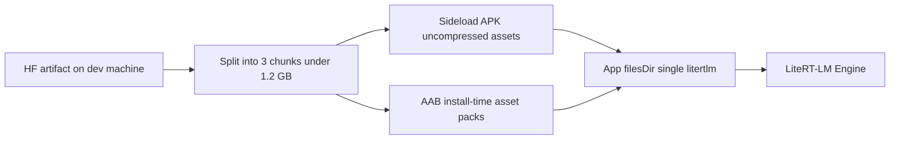

# Gemma 3n E2B on-device deployment (Android)

This document covers packaging, build, verification, testing, and device validation for **Gemma 3n E2B** prescription extraction using [LiteRT-LM](https://github.com/google-ai-edge/litert-lm) on Android. Production inference uses **install-time packaged weights** (no Hugging Face download at runtime).

## Architecture



| Layer | Responsibility |
|-------|----------------|
| `scripts/download_gemma_model.py` | Download, verify, split, write `CHECKSUM.txt` |
| `android/gemma_packaging.gradle.kts` | Copy chunks into APK assets + asset packs (release-gated) |
| `GemmaChunkInstaller` (Kotlin) | Concatenate chunks → `filesDir`, verify SHA-256 + size |
| `GemmaModelManager` / `GemmaInferenceEngine` | LiteRT-LM `0.19.1`, CPU baseline, image + prompt |
| `GemmaExtractionService` (Dart) | Orchestrates materialize → infer → map to review draft |
| `PrescriptionExtractionOrchestrator` | Gemma-only prescription extraction when weights are packaged |

Method channel: `com.prescriptionreader/gemma` (see plan / `GemmaPlatformChannel.kt`).

## Model (pinned)

| Field | Value |
|-------|--------|
| Hugging Face repo | `google/gemma-3n-E2B-it-litert-lm` |
| Artifact | `gemma-3n-E2B-it-int4.litertlm` (~3.66 GB) |
| Licence | [Gemma](https://ai.google.dev/gemma/terms) (gated on Hugging Face) |
| Native dependency | `com.google.ai.edge.litertlm:litertlm-android:0.19.1` |

Accept the Gemma licence on Hugging Face for your account before downloading. **Do not commit tokens or weight files** (`models/`, `**/*.litertlm` are gitignored).

## Download and checksum (developer machine)

```bash
# Set after accepting the licence at https://huggingface.co/google/gemma-3n-E2B-it-litert-lm
export HF_TOKEN=your_token_here

python scripts/download_gemma_model.py
```

Outputs under `models/gemma3n/`:

- `gemma-3n-E2B-it-int4.litertlm`
- `gemma.part0` … `gemma.part2` (each ≤ 1.2 GiB)
- `CHECKSUM.txt` (`sha256`, `size_bytes`, per-chunk hashes)

The script refuses short files, resumes partial HF downloads, and skips re-download when on-disk size and SHA-256 already match `CHECKSUM.txt` / hub metadata.

## Packaging

**Why not Flutter assets:** Play base module limit (500 MB), single asset pack limit (1.5 GB), and ~3.66 GB quantized weights exceed practical APK/AAB entry limits without splitting.

| Target | Mechanism |
|--------|-----------|
| Sideload APK | Chunks in `android/app/src/main/assets/gemma/` with `noCompress` |
| Play AAB | `:gemma_pack0` … `:gemma_pack2`, `deliveryType = install-time` |

- **Debug builds** default to *no* weights (~300 MB APK); prescription flow reports *model not packaged*.
- **Debug with Gemma** (Android Studio / `flutter run`): set `packageGemmaInDebug=true` (see below).
- **Release / bundle** builds **fail** if `models/gemma3n/CHECKSUM.txt` or chunks are missing or checksums mismatch (`prepareGemmaModelChunks`).

### Debug with Gemma in Android Studio

Use this for breakpoints + hot reload on a physical **arm64** phone while still shipping the ~3.7 GB weights in the **debug** APK.

1. Download weights on the dev machine (`python scripts/download_gemma_model.py`).
2. Enable debug packaging (either file; **do not commit `true` to git** for daily work):

   **`android/gradle.properties`** (project-wide):

   ```properties
   packageGemmaInDebug=true
   ```

   or **`android/local.properties`** (machine-only, recommended):

   ```properties
   packageGemmaInDebug=true
   ```

3. In Android Studio: open the Flutter project root, select your **Redmi / arm64** device (not Chrome), **Run** `lib/main.dart` (green play).
4. First `assembleDebug` copies and verifies chunks (~long build). The debug APK is **~4 GB** — allow time to install; on MIUI enable **USB debugging (Security settings)** / **Install via USB**.
5. On device: ensure ~**8 GB free** storage for first-time model materialization.
6. When finished Gemma testing, set `packageGemmaInDebug=false` again for normal small debug APKs.

CLI equivalent:

```bash
flutter build apk --debug -PpackageGemmaInDebug=true
```

### Install-time storage (user device)

- Play may require ~**2× pack size** free during install ([asset delivery](https://developer.android.com/guide/playcore/asset-delivery)).
- First launch **concatenates once** into `filesDir` (~3.66 GB) unless already materialized (idempotent).
- Plan for ~**8 GB free storage** on device (pack + materialized copy + headroom), not only RAM.

## Device requirements

| Requirement | Detail |
|-------------|--------|
| ABI | **arm64-v8a** for Gemma (`deviceSupportsLitertLm`); x86_64 emulators use OCR fallback only |
| RAM | ≥ **8 GB** device RAM recommended; engine gate uses **2.5 GB available** minimum before load |
| Storage | ~**8 GB free** for install + first materialization |
| Network at inference | **None** (airplane mode OK after install) |
| Play install-time cap | Cumulative install-time packs + base ≤ **4 GB** |

Backend: **CPU** baseline; GPU/NPU probed only after CPU works, with fallback on failure.

Inference: **one image per request**, `maxNumTokens = 4096`, image long edge capped at **768** px.

## Build commands

```bash
flutter pub get

# Debug (no weights required)
flutter build apk --debug

# Release APK (requires models/gemma3n/CHECKSUM.txt + chunks)
flutter build apk --release

# Play bundle (install-time asset packs)
flutter build appbundle --release
```

Android: `minSdk 30`, `targetSdk 35`, `compileSdk 36`, Kotlin **2.4.0**, AGP **9.1.0**.

## Release artifact verification

> **Status (this repo checkout):** A release APK/AAB **with bundled Gemma weights was not built** in CI or in the agent environment documented here, because `models/gemma3n/` weights are not present in git. **Do not claim the model is bundled** until you complete the steps below on a machine that ran `download_gemma_model.py`.

After a **successful release build on a machine with weights**:

### APK (sideload)

```bash
flutter build apk --release
APK=build/app/outputs/flutter-apk/app-release.apk

# List gemma assets (expect CHECKSUM.txt + gemma.part0..2; names may vary by flavor)
unzip -l "$APK" | grep -E 'assets/gemma/'

# Optional: total APK size
ls -lh "$APK"
```

Confirm:

- Three chunk files and `CHECKSUM.txt` under `assets/gemma/`
- Chunk sizes match `models/gemma3n/CHECKSUM.txt`
- Total APK size is multi-GB when weights are included

### AAB (Play)

```bash
flutter build appbundle --release
AAB=build/app/outputs/bundle/release/app-release.aab

# Inspect with bundletool (install bundletool.jar first)
java -jar bundletool.jar validate --bundle="$AAB"
java -jar bundletool.jar dump manifest --bundle="$AAB" | findstr /i gemma
```

Record in your release notes: APK/AAB file size, installed storage after first launch, init time, peak PSS, image latency, backend used.

## Automated tests (no weights)

### Dart

```bash
flutter test test/services/inference/gemma/
```

Covers: JSON fence stripping, draft mapping, model status / compatibility, idempotent `ensureMaterialized` when already materialized.

### JVM (Android module)

```bash
cd android
./gradlew :app:testDebugUnitTest
```

Covers: JSON parse rejection, schema key filtering, `CHECKSUM.txt` parsing / missing `sha256` errors.

Idempotent “already materialized” behavior is covered in Dart (`ensureMaterialized` skips `materializeModel` when `materialized: true`).

## Manual device checklist

Run on a **physical arm64** phone with **≥ 8 GB RAM**, weights packaged in the build, **airplane mode** after install.

### Environment

- [ ] Release or profile build with `CHECKSUM.txt` + chunks present at build time
- [ ] Airplane mode on (no HF / runtime model download)
- [ ] ≥ 8 GB free storage before first Gemma extraction

### Model lifecycle

- [ ] `checkModelStatus`: `packaged=true`, `arm64=true`, no compatibility error
- [ ] First launch: concat progress events, materialized `true` after success
- [ ] Second launch: no re-copy (`materialized` stays true, fast path)
- [ ] `initializeModel` → `engineReady`
- [ ] `releaseModel` / `release` then re-init works
- [ ] Low storage: clear error when free space below installer threshold

### Extraction

- [ ] Printed Rx: medicines appear on review screen, method shows on-device Gemma / similar label
- [ ] Handwriting / blur / rotation: falls back or flags uncertain fields
- [ ] Multi-medicine Rx: multiple review rows
- [ ] Missing duration / illegible dose: `needs_verification` or uncertain confidence, editable fields
- [ ] Parse failure: OCR + rules fallback, user informed Gemma did not win

### Prescription image set (record outcomes; do not invent benchmark %)

| Scenario | Exact field match? | Valid JSON? | Notes |
|----------|-------------------|-------------|-------|
| Printed, clean | | | |
| Handwriting | | | |
| Blur | | | |
| Rotation | | | |
| Multi-medicine | | | |
| Missing duration | | | |
| Illegible dose | | | |
| Multi-page (separate captures) | | | |

### Telemetry to capture (per build)

| Metric | Value |
|--------|-------|
| APK size | |
| AAB size | |
| Installed storage after materialize | |
| Model init time | |
| Peak PSS during image inference | |
| Image inference latency | |
| Backend (CPU / GPU) | |

## Limitations

- arm64-only for Gemma inference; emulators use OCR path
- ~8 GB RAM and ~8 GB storage planning
- Play 4 GB install-time asset ceiling
- CPU baseline; one image per request; 4096-token context
- Install-time packs cannot be removed; footprint may include pack + `filesDir` copy
- Debug `/dev/model-spike` path (`Gemma3nLitertService` + HF download) is **not** production

## Related files

| Path | Role |
|------|------|
| `scripts/download_gemma_model.py` | HF download + chunking |
| `android/gemma_packaging.gradle.kts` | Release packaging gate |
| `lib/services/inference/gemma_extraction_service.dart` | Production Dart entry |
| `assets/prompts/prescription_extraction_system.txt` | System prompt |
| `lib/features/prescription/domain/prescription_extraction_orchestrator.dart` | Fallback order |
