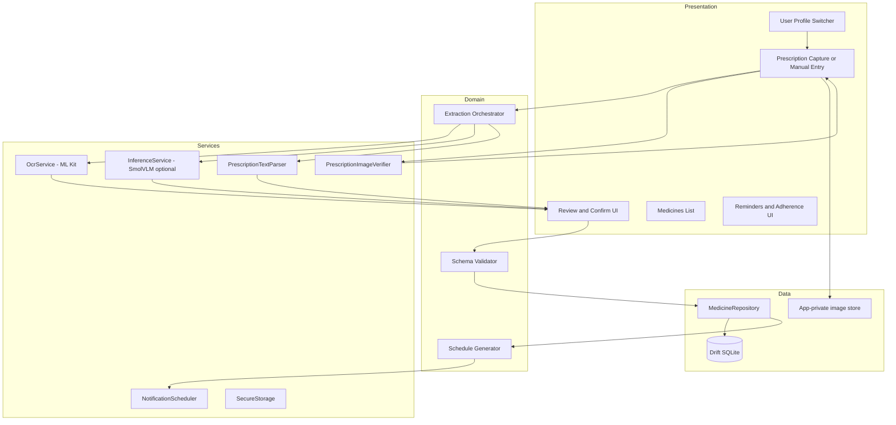
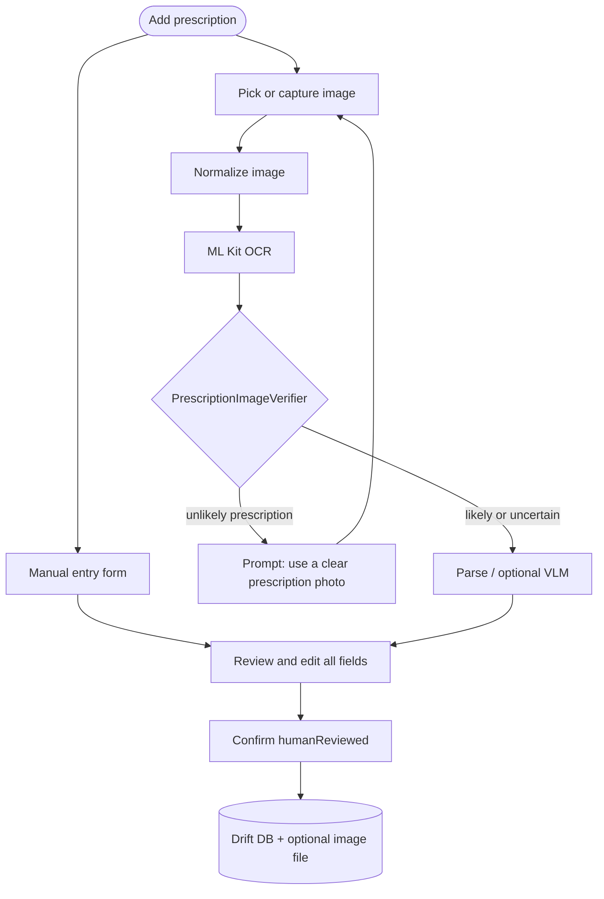
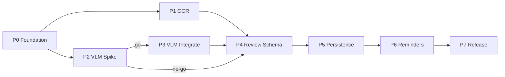

# Architecture

This document distills the medicine reminder app structure: layered modules, extraction flow, repository layout, and **architecture decision record (ADR) stubs**. ADRs move from *Proposed* to *Accepted* as implementation phases complete.

## Goals

- **Offline-first:** Core flows work without network after prerequisites (OCR model bundled; optional VLM downloaded once).
- **Multi-profile on device:** Several **local user profiles** (each with a stable UUID); no cloud login in v1. All persisted rows are tagged with `userId`.
- **Single in-app database:** One Drift/SQLite file in app-private storage; isolation by `userId` foreign keys, not separate DB files per person.
- **Assistive extraction:** OCR and optional VLM suggest fields; the user must **confirm** (`humanReviewed`) before schedules and reminders activate.
- **Manual entry:** Users can create a prescription and medicines **without** an image (same review and persistence rules).
- **Testable boundaries:** Features depend on interfaces (`MedicationExtractionService`, `PrescriptionImageVerifier`, repositories), wired with Riverpod.

## Layered modules



| Layer | Location | Responsibility |
|-------|----------|----------------|
| **Presentation** | `lib/features/*/presentation/` | Screens, widgets, user input |
| **Domain** | `lib/features/*/domain/`, `lib/shared/validation/` | Entities, use cases, schedule rules, validation |
| **Services** | `lib/services/` | OCR, inference, tokenization, preprocessing |
| **Data** | `lib/data/`, `lib/features/*/data/` | Drift DB, repositories, file stores |
| **App shell** | `lib/app/` | `MaterialApp`, `go_router`, global providers |

## Storage layout (multi-user, in-app)

### Database

| Property | Choice |
|----------|--------|
| Engine | Drift → single SQLite file under app-private documents (e.g. `medicine_reminder.db`) |
| Tenancy | Every prescription, medicine, schedule, and adherence row includes **`userId`** (UUID FK → `user_profiles`) |
| Active context | `ActiveUserId` in app state (Riverpod); repositories reject cross-user writes |

### On-disk files (per user)

Prescription images are **optional**. When present, files live under the active profile, not in shared storage:

```
{appDocuments}/users/{userId}/prescriptions/{prescriptionId}/
  image.enc          # optional; encrypted at rest (Phase 5)
```

Manual prescriptions omit `image.enc`; `prescription.source = manual` and `imagePath` is null.

### Logical entities (per user)

Each profile owns its own timeline of care. All entities use **UTC ISO-8601** instants in the DB.

| Entity | Identity & tagging | Core fields | Time bounds |
|--------|-------------------|-------------|-------------|
| **`UserProfile`** | `userId` (UUID) | Display name, avatar optional, `createdAt` / `updatedAt` | Profile lifetime |
| **`Prescription`** | `prescriptionId` (UUID), **`userId`**, **`capturedAt`** (unique import/capture instant per row) | Optional image ref; **`reviewStatus`** + **`humanReviewedAt`**; EHR: `doctorName`, `diagnosis`, `testsSuggested`, `facilityName`, `notes` (all optional); `source`: `camera` \| `gallery` \| `manual` | **`validFrom`** / **`validTo`** (care episode or Rx validity window; user-editable) |
| **`Medicine`** (on prescription) | `medicineId`, `prescriptionId`, `userId` | Name, strength, route, dose instructions, linked **`ScheduleRule`** / **timing** | **`startAt`** / **`endAt`** per medicine course |
| **`ScheduleRule` / timing** | `scheduleId`, `medicineId`, `userId` | Frequency, explicit times, timezone | Active only between medicine `startAt`–`endAt` |
| **`ReminderEvent` / adherence** | ids + `userId` | Fired/skipped/taken | Event timestamps |

**Human review gate:** `reviewStatus` is `draft` until the user completes review; only `confirmed` prescriptions activate reminders. `humanReviewedAt` is set on confirm (required for `confirmed`).

**Prescription timestamp:** `capturedAt` is assigned at create time (camera, gallery import, or manual “create prescription”) and never reused across prescriptions; it sorts and audits imports within a profile.

Detailed column DDL is specified in Phase 5 (`docs/data-model.md`); the above is the canonical product shape.

## Import paths: image OCR vs manual entry



- **Manual entry:** User opens “Enter prescription manually” → empty draft with EHR + medicine fields → same review/confirm gate; no verifier step.
- **Image path:** After OCR, **`PrescriptionImageVerifier`** scores whether the image/text looks like a prescription (heuristics: medication keywords, dosage patterns, clinician/hospital cues, minimum text structure; optional VLM assist later). **`unlikely`** blocks extraction review and asks for a clearer prescription photo; **`uncertain`** allows proceed with a visible warning; **`likely`** proceeds normally.

## Extraction pipeline (logical)

1. **Profile context** — Operations run under the selected `userId`.
2. **Capture or manual** — Image → normalize to temp path **or** manual draft with `source = manual`.
3. **OCR** (image only) — ML Kit → `OcrResult`.
4. **Prescription verification** (image only) — `PrescriptionImageVerifier` → `likely` \| `uncertain` \| `unlikely`; reject `unlikely` in UI.
5. **Optional VLM** — If Phase 2 go and models installed → structured JSON from image + prompt.
6. **Parse** — Map to `MedicationExtractionDraft` with per-field `FieldConfidence` (`known` \| `uncertain` \| `missing`), including EHR fields when present in text.
7. **Validate** — Business rules (e.g. no active schedule without confirmed frequency).
8. **Review UI** — User edits → **Confirm** → sets `humanReviewedAt`, `reviewStatus = confirmed` → persisted `MedicationRecord` / medicines.
9. **Schedule** — Only after confirm → persist reminders for that `userId`.

## Inference abstraction

Planned interface in `lib/services/inference/medication_extraction_service.dart`:

```dart
abstract class MedicationExtractionService {
  Future<ExtractionCapability> getCapability();
  Future<MedicationExtractionDraft> extract(ExtractionRequest request);
  Future<void> dispose();
}
```

Implementations (by phase):

| Implementation | Phase | Notes |
|----------------|-------|--------|
| `OcrOnlyExtractionService` | 1 | Baseline |
| `OcrPlusRulesExtractionService` | 1 / 4 | Rules on OCR text |
| `SmolVlmOnnxExtractionService` | 3 | Gated on Phase 2 go/no-go |

## Repository layout (`lib/`)

| Path | Responsibility |
|------|----------------|
| `main.dart` | Entry; `ProviderScope` + router (wired in later P0 tasks) |
| `app/app.dart` | Theme, root widget |
| `app/router.dart` | `go_router` routes |
| `app/di/providers.dart` | Riverpod providers for services and repos |
| `features/users/` | Local profiles, active-user selection (planned) |
| `features/prescription/` | Capture, manual entry, OCR review, extraction review, image store |
| `features/medicines/` | Confirmed meds list, `MedicineRepository` |
| `features/reminders/` | Planner, notifications, adherence |
| `services/ocr/` | ML Kit wrapper, `PrescriptionImageVerifier` |
| `services/inference/` | Extraction, VLM loop, assets, tokenizer |
| `shared/models/` | `FieldConfidence`, shared types |
| `shared/validation/` | Schema and extraction validators |
| `data/database/` | Drift `AppDatabase`, tables, migrations |

## Technology choices (baseline)

| Concern | Choice | Rationale |
|---------|--------|-----------|
| State / DI | `flutter_riverpod` | Testable, low ceremony |
| Navigation | `go_router` | Deep links and multi-step review flows |
| Database | `drift` + `sqlite3_flutter_libs` | Migrations, typed queries |
| OCR | `google_mlkit_text_recognition` (Phase 1) | Bundled offline Latin model |
| Notifications | `flutter_local_notifications` (Phase 6) | Local schedules + reboot hooks |
| VLM spike | `flutter_onnxruntime` (Phase 2+) | HF-published ONNX shards |

## Architecture decision records (stubs)

Each ADR follows: **Status**, **Context**, **Decision**, **Consequences**. Update status when the related phase ships.

---

### ADR-001: Offline-first local data

| | |
|--|--|
| **Status** | Proposed |
| **Context** | Users need reminders without cloud accounts or continuous connectivity. |
| **Decision** | One in-app SQLite database; all rows tagged with `userId`; optional encrypted images under per-user paths; optional one-time VLM download only. |
| **Consequences** | No cloud sync in v1; backup/export is out of scope unless added later. Encryption for images planned in Phase 5. Repositories must scope queries by active profile. |

---

### ADR-002: OCR-first, VLM optional and gated

| | |
|--|--|
| **Status** | Proposed |
| **Context** | SmolVLM ONNX requires three graphs, custom generation loop, and high RAM on 4 GB devices. |
| **Decision** | Ship MVP on ML Kit OCR + rules + manual edit; run Phase 2 spike before any Phase 3 VLM integration. |
| **Consequences** | `MedicationExtractionService` must support swapping implementations; UI must not depend on VLM. |

---

### ADR-003: Riverpod for state and dependency injection

| | |
|--|--|
| **Status** | Accepted (dependency added P0-03) |
| **Context** | Need testable providers for repos, OCR, and extraction without a custom service locator. |
| **Decision** | Use `flutter_riverpod` with providers in `lib/app/di/providers.dart`. |
| **Consequences** | Root `main.dart` wraps app in `ProviderScope`; widget tests override providers as needed. |

---

### ADR-004: go_router for navigation

| | |
|--|--|
| **Status** | Accepted (dependency added P0-03) |
| **Context** | Multi-step flows: capture → OCR review → extraction review → medicines list. |
| **Decision** | Centralize routes in `lib/app/router.dart`. |
| **Consequences** | `MaterialApp.router` replaces imperative-only navigation as routes are implemented. |

---

### ADR-005: Drift for SQLite persistence

| | |
|--|--|
| **Status** | Accepted (dependency added P0-03) |
| **Context** | Versioned schema, migrations, and type-safe queries for meds and reminders. |
| **Decision** | `AppDatabase` in `lib/data/database/` with `drift_dev` + `build_runner` codegen. |
| **Consequences** | Table changes require `dart run build_runner build`; migration tests in Phase 5. |

---

### ADR-006: Android-first platform target

| | |
|--|--|
| **Status** | Proposed |
| **Context** | ML Kit bundled OCR and ONNX spike target physical Android devices (4–6 GB RAM). |
| **Decision** | `minSdk 24`; prioritize Android notifications and boot reconciliation; defer iOS parity. |
| **Consequences** | iOS project exists from `flutter create` but is not validated for VLM/OCR in v1. |

---

### ADR-007: Explicit user confirmation before reminders

| | |
|--|--|
| **Status** | Proposed |
| **Context** | Extraction is assistive, not clinical advice; hallucinated schedules are unacceptable. |
| **Decision** | `reviewStatus` must be `confirmed` and `humanReviewedAt` set before `ReminderEvent` is active; validator blocks premature scheduling. |
| **Consequences** | Review screens are mandatory gates for both OCR and manual entry; tests assert no notifications from draft-only data. |

---

### ADR-008: Single active extraction on low-RAM devices

| | |
|--|--|
| **Status** | Proposed |
| **Context** | VLM inference may use ~1.8 GB peak on 4 GB phones. |
| **Decision** | At most one in-flight extraction; dispose sessions when leaving review or on cancel. |
| **Consequences** | UI disables parallel imports during VLM; `dispose()` on `MedicationExtractionService` is required. |

---

### ADR-009: Local multi-user profiles (no cloud accounts)

| | |
|--|--|
| **Status** | Proposed |
| **Context** | One device may manage medications for multiple people (e.g. family); data must not leak across profiles. |
| **Decision** | `UserProfile` table with UUID `userId`; all domain tables include `userId`; single shared Drift database; UI profile switcher sets active user. |
| **Consequences** | No remote authentication; deleting a profile cascades its prescriptions, images, and reminders. Default profile created on first launch. |

---

### ADR-010: Prescription image verification before extraction review

| | |
|--|--|
| **Status** | Proposed |
| **Context** | Random photos (selfies, bills) should not flow into medication extraction. |
| **Decision** | After OCR, run `PrescriptionImageVerifier` (rules on OCR text + layout signals); `unlikely` → block and prompt for a clear prescription image; manual entry bypasses image verification. |
| **Consequences** | False negatives require “Continue anyway” only for `uncertain`, not `unlikely`; verifier unit tests use labeled non-Rx images. |

---

### ADR-011: Manual prescription entry parity

| | |
|--|--|
| **Status** | Proposed |
| **Context** | Users may have no photo or failed OCR. |
| **Decision** | “Enter manually” creates a `Prescription` with `source = manual`, optional image later; same EHR fields, medicines, timing, and human review gate as the OCR path. |
| **Consequences** | `prescription_import.dart` exposes `createManualDraft()` and `importFromImage()`; shared review screen. |

---

## Related documents (planned)

| Document | Phase |
|----------|-------|
| `docs/data-model.md` | 5 — Drift tables and JSON schemas |
| `docs/offline-capabilities.md` | 1 — Airplane-mode checklist |
| `docs/model-research.md` | 2 — VLM spike, go/no-go |
| `docs/testing.md` | 7 — CI and device matrix |

## Phase dependency (high level)


